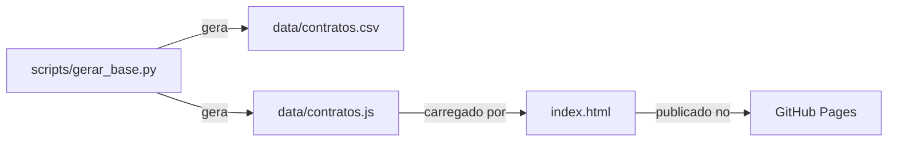

# contract-kpi-dashboard

Painel de acompanhamento de contratos que cruza **prazo decorrido** com **valor consumido** para mostrar, em uma única tela, quais contratos vão estourar o saldo antes do fim da vigência e quais estão parados.

**[Abrir a demonstração](https://olandamatheus.github.io/contract-kpi-dashboard/)**

> Todos os dados são **fictícios**, gerados por script. Nenhuma empresa, fornecedor ou contrato real.

## O problema

Em gestão de contratos, olhar só o "% consumido" engana. Um contrato com 80% consumido pode estar saudável (se 80% do prazo já passou) ou em risco (se passaram só 40%). A pergunta que Controladoria e Suprimentos precisam responder é:

> O consumo está acompanhando o prazo?

## A solução

Cada contrato vira uma linha do tempo:

- a **barra clara** é a vigência (início ao fim)
- a **barra escura** é o valor consumido, desenhado na mesma escala
- a **linha tracejada** é a data de referência

Se a barra escura passa da linha de hoje, o consumo está à frente do prazo. Se ultrapassa o fim da vigência, o valor contratado já foi superado e precisa de aditivo.

### Classificação automática

| Situação | Regra |
|---|---|
| Acima do contratado | consumido > 100% do valor |
| Consumo acelerado | % consumo supera % prazo em mais de 15 pontos |
| Subutilizado | % prazo supera % consumo em mais de 25 pontos |
| No ritmo | demais contratos vigentes |
| Encerrado | vigência terminou antes da data de referência |

Os limites ficam em constantes no topo do script da página, fáceis de ajustar à política de cada área.

## Funcionalidades

- Resumo em texto e totais (contratado, consumido, saldo, vencimentos em 90 dias)
- Filtros por situação e categoria, que valem para todas as visões
- Ordenação por vencimento, desvio de consumo ou valor
- Consumo por categoria
- Tabela completa ordenável por qualquer coluna
- Detalhe de cada contrato ao passar o mouse, tocar ou navegar pelo teclado
- Tema claro e escuro automático, layout adaptado ao celular

## Arquitetura



- **Python** gera a base fictícia com semente fixa (sempre os mesmos números) e data de referência fixa
- **HTML + CSS + JavaScript puro**, sem frameworks nem bibliotecas de gráfico: a página abre direto do disco ou do GitHub Pages
- O CSV sai no formato típico de extração de ERP (`;`, `dd.mm.aaaa`, vírgula decimal), compatível com as funções do repositório [powerquery-patterns](https://github.com/OlandaMatheus/powerquery-patterns)

## Decisões técnicas

- **Data de referência vem da base, não do relógio.** Indicadores de vencimento calculados com "hoje" mudam sozinhos sem a base mudar, e deixam de bater com a extração.
- **Base embutida em `.js` em vez de `fetch()` de JSON.** Assim a página funciona até aberta pelo explorador de arquivos, sem servidor.
- **Um único componente de tooltip** para todas as visões, com o mesmo comportamento no mouse, no toque e no teclado.

## Como rodar

```bash
python scripts/gerar_base.py   # opcional: regera a base
```

Depois, abra o `index.html` no navegador.

## Licença

MIT
